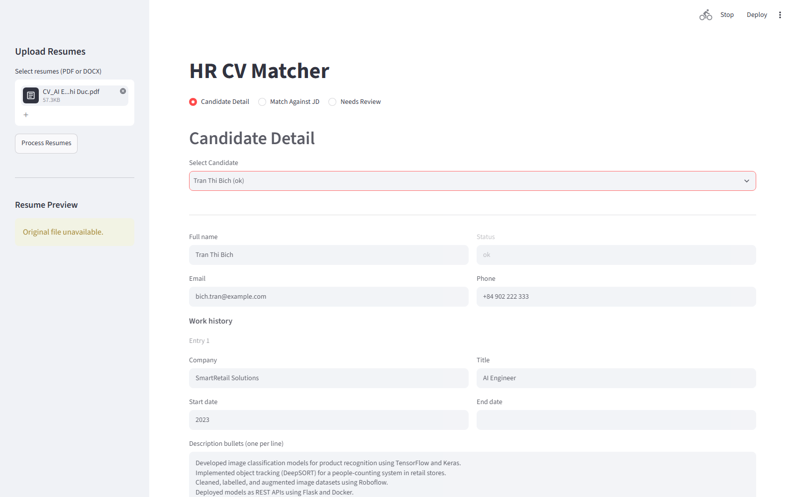
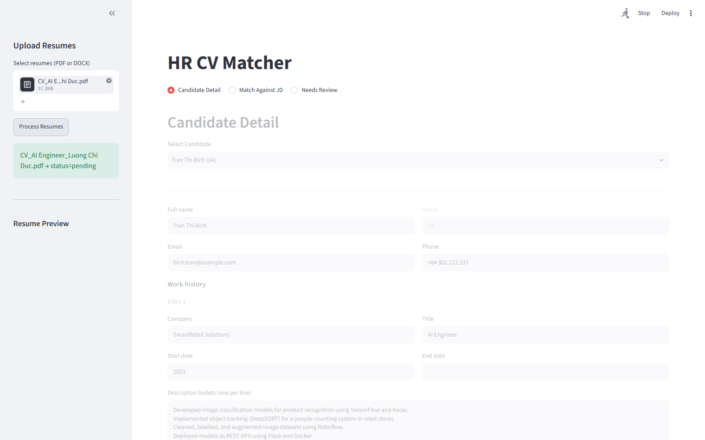
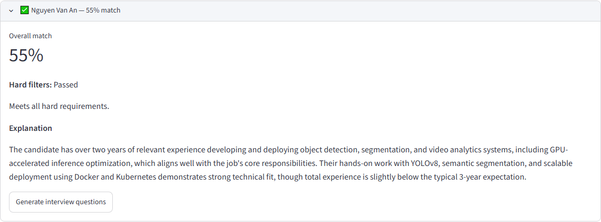
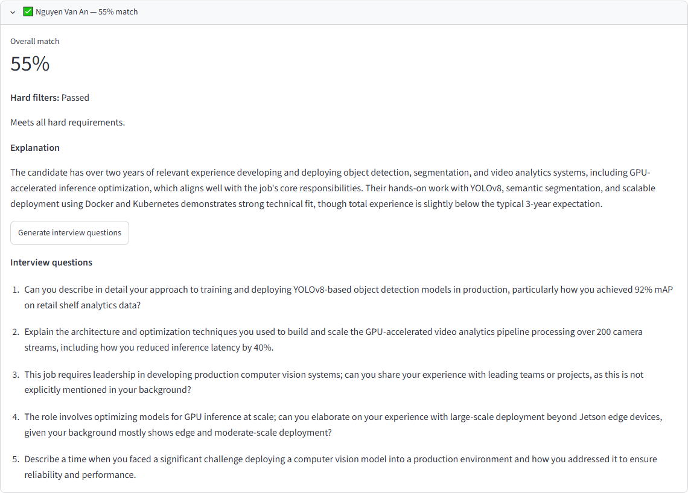
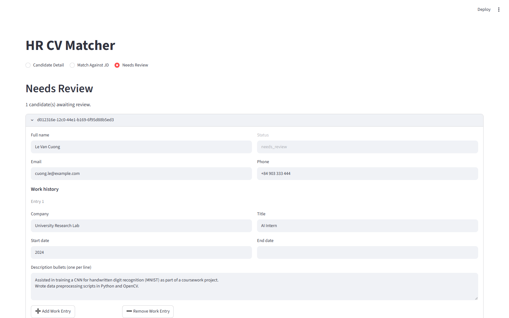

# hr-cv-matcher

**Upload resumes and a job description, get a ranked, explained shortlist and
draft interview questions — without a recruiter ever touching a spreadsheet.**

`hr-cv-matcher` parses resumes (PDF/DOCX, including scanned images via OCR/VLM)
into a structured candidate profile, matches candidates against a job
description using hard filters plus embedding-based fit scoring, generates a
plain-language explanation for every match, and drafts interview questions
tailored to a candidate/job pair. A Streamlit dashboard drives the whole flow
for a human reviewer.

## Contents

- [Architecture](#architecture)
- [Why no job queue, why no vector DB](#why-no-job-queue-why-no-vector-db)
- [Setup](#setup)
- [Using the demo](#using-the-demo)
- [Design decisions & PII/fairness](#design-decisions--piifairness)
- [Screenshots](#screenshots)

## Architecture

```text
                        ┌─────────────────────────┐
                        │   Streamlit frontend    │
                        │  (frontend/streamlit_   │
                        │        app.py)          │
                        └───────────┬─────────────┘
                                    │ HTTP
                                    ▼
                        ┌────────────────────────┐
                        │       FastAPI app      │
                        │        (main.py)       │
                        │ ┌───────────────────┐  │
                        │ │ api/candidates.py │  │──▶ upload, poll status,
                        │ │ api/jobs.py       │  │    render template
                        │ │ api/matches.py    │  │──▶ create job, run match
                        │ │ api/interview.py  │  │──▶ generate questions
                        │ └───────────────────┘  │
                        └───────────┬─────────────┘
                                    │
        ┌───────────────┬──────────┼───────────────┬────────────────┐
        ▼               ▼          ▼               ▼                ▼
┌───────────────┐ ┌────────────┐ ┌───────────┐ ┌────────────────┐ ┌────────────┐
│ Ingestion +   │ │ Extraction │ │ Matching  │ │ Interview      │ │ Template   │
│ OCR/VLM       │ │ Service    │ │ Service   │ │ Service        │ │ Service    │
│ router        │ │ (LLM       │ │ (hard     │ │ (LLM question  │ │ (docxtpl + │
│ (pymupdf /    │ │  structured│ │  filters +│ │  generation)   │ │  tectonic) │
│  PaddleOCR /  │ │  extract,  │ │  embedding│ │                │ │            │
│  datalab /    │ │  retries)  │ │  fit)     │ │                │ │            │
│  qwen2_vl)    │ │            │ │           │ │                │ │            │
└───────┬───────┘ └─────┬──────┘ └─────┬─────┘ └────────┬───────┘ └─────┬──────┘
        │               │              │                │               │
        └───────────────┴────────┬─────┴────────────────┴───────────────┘
                                 ▼
                      ┌─────────────────────┐
                      │     Postgres        │
                      │ candidates, jobs,   │
                      │ matches,            │
                      │ interview_questions,│
                      │ embedding_cache     │
                      └─────────────────────┘
```

The pipeline for a single resume: **upload → background task → OCR/VLM text
extraction → LLM structured extraction (with PII scrubbing and retries) →
stored as a `CandidateProfile`**. Matching then runs hard filters (years of
experience, education level) followed by an embedding-similarity "soft fit"
score between the candidate's experience bullets and the JD's requirement
lines, and an LLM writes a short natural-language explanation of the result.

## Why no job queue, why no vector DB

At this project's scale — a single HR team processing dozens to low hundreds
of resumes at a time — two infrastructure pieces that a "proper" hybrid
retrieval system would include are deliberately left out:

- **No job queue (Celery/arq/procrastinate).** Resume processing runs as a
  FastAPI `BackgroundTask` kicked off directly from the upload endpoint
  (`api/candidates.py`). This avoids running and monitoring a separate worker
  process/broker for a workload that's bursty but low-volume. If ingestion
  volume grew to the point of needing retries-with-backoff, distributed
  workers, or task prioritization across many concurrent recruiters, swapping
  the `BackgroundTask` call for a queue task is a localized change — the
  ingestion/extraction logic in `services/` is already decoupled from the API
  layer that invokes it.
- **No vector database (Qdrant/pgvector).** Candidate-pool matching keeps
  embeddings as plain `numpy` arrays and does cosine similarity in memory
  (`services/matching_service.py`), with `services/embedding_service.py`
  caching every computed vector in a plain Postgres table
  (`embedding_cache`) so the same text is never re-embedded. This is
  appropriate while a single job's candidate pool is small enough to fit
  comfortably in memory. If the candidate pool or job catalog grew by an
  order of magnitude and needed approximate nearest-neighbor search across
  a large corpus, `embedding_cache` already stores exactly what a vector DB
  ingestion job would need to backfill — the swap-in point is
  `EmbeddingService`/`MatchingService`, not the schema.

## Setup

Prerequisites: Docker, Python 3.11+, and (only if you'll use the
`render-template` endpoint) the [`tectonic`](https://tectonic-typesetting.github.io/)
LaTeX engine on your `PATH`.

1. **Clone and configure environment variables**

   ```bash
   git clone <this-repo-url>
   cd hr-cv-matcher
   cp .env.example .env
   # Fill in LLM_API_KEY (Anthropic key) at minimum. Defaults work for
   # everything else on a typical dev machine.
   ```

2. **Start everything**

   ```bash
   docker compose up -d --build
   ```

   This starts Postgres (`localhost:5434`), runs migrations, and starts both
   the FastAPI app (`localhost:8002`) and the Streamlit dashboard
   (`localhost:8501`) — all ports configurable via `.env`. Open
   `http://localhost:8501`.

   Running on a VPS or anywhere reachable beyond your own machine? Change
   `POSTGRES_PASSWORD` from the default in `.env`, and set `API_KEY` /
   `APP_API_KEY` (see below) — without them, anyone who can reach the ports
   above can read every candidate's PII.

### Running without Docker

For local development against the pieces individually:

```bash
docker compose up postgres -d
python -m venv venv
source venv/bin/activate   # venv\Scripts\Activate.ps1 on Windows
pip install -r requirements.txt
alembic upgrade head
uvicorn main:app --reload --port 8002
streamlit run app/streamlit.py --server.port 8501
```

If you plan to use the `paddle_vlm` OCR backend on GPU (rather than the CPU
default), see the GPU setup notes further down in this file before running
anything GPU-backed.

## Using the demo

1. **Candidate Detail tab** — upload one or more resumes (PDF, DOCX, or
   scanned images) from the sidebar. Each upload returns immediately with
   `status: "pending"`; the dashboard polls until extraction completes
   (`ok` or `needs_review`). Review/edit the extracted profile, and
   optionally render it into the company resume template.
2. **Match Against JD tab** — upload or paste a job description, run
   matching against the candidate pool, and see a ranked list where each
   candidate shows pass/fail on hard filters, a soft-fit score, and an
   LLM-generated explanation. Generate interview questions for any
   candidate/job pair from here.
3. **Needs Review tab** — candidates whose extraction failed after retries,
   or whose match fell inside the experience-tolerance band, surface here
   for a human decision.

## Design decisions & PII/fairness

- **Excluded protected-characteristic fields.** `CandidateProfile`
  (`models/candidate.py`) deliberately excludes `date_of_birth`, `age`,
  `photo`, `nationality`, `marital_status`, and `gender`. These fields are
  never extracted, stored, scored on, or referenced in a match explanation —
  this exclusion is structural (the schema has no field for them), not a
  policy applied after the fact. As defense-in-depth against these terms
  leaking into free-text fields anyway, `utils/pii_scrub.py` strips mentions
  of date of birth, age, marital status, and nationality from any text
  pulled from a resume before it's stored.
- **Decision-support only.** This tool never auto-rejects or auto-advances a
  candidate. Every candidate that fails a hard filter or scores low is still
  visible to the reviewer with its notes attached, and every match requires
  a human to act on it — the API and UI expose scores and explanations, not
  decisions.
- **Hard-filter-then-soft-fit, not a full hybrid retrieval stack.** Matching
  is a two-stage, fully transparent pipeline: (1) non-negotiable hard filters
  (years of experience with a documented tolerance band, education level)
  that produce a human-readable pass/fail reason, then (2) a soft-fit score
  from averaged best-match cosine similarity between each JD requirement
  line and each candidate experience bullet. This is a deliberate simplicity
  trade-off against a hybrid retrieval stack (e.g. BM25 + dense retrieval +
  a reranker) that would improve ranking quality at the cost of being
  considerably harder to explain to an HR reviewer — every score in this
  system traces back to a specific requirement line and a specific resume
  bullet.

## Screenshots

**Upload flow** — attaching a resume in the Candidate Detail sidebar, then
after processing completes:




**Ranked match list** with a candidate's explanation expanded:



**Generated interview questions** for the same candidate/job pair:



**Needs Review tab** — a candidate flagged for manual review, shown with its
editable correction form:



All data shown above is synthetic (from `eval/seed_eval_data.py`) — no real
candidate PII appears in these screenshots.

## GPU setup (OCR_VLM_BACKEND=paddle_vlm)

`requirements.txt` installs the CPU build of `paddlepaddle`, which is enough
for the fast OCR tier (PP-OCRv6) and for the `datalab`/`qwen2_vl` VLM
backends. The `paddle_vlm` backend (PaddleOCR-VL 1.6) needs the GPU build
instead, which is not on PyPI and must be installed from PaddlePaddle's own
index, matching your installed CUDA version:

```bash
pip uninstall paddlepaddle
pip install paddlepaddle-gpu==3.3.1 -i https://www.paddlepaddle.org.cn/packages/stable/cu126/
```

Replace `cu126` with the index matching your CUDA toolkit (check with
`nvidia-smi`; other options include `cu118`, `cu123`). If you see a warning
like `Paddle is compiled with CUDNN 9.9, but CUDNN version in your machine is
9.5`, align the bundled cuDNN wheel with what Paddle expects:

```bash
pip install nvidia-cudnn-cu12==9.9.0.52
```

The `PaddleOCR-VL-1.6` and `PP-DocLayoutV3` model weights (~2GB) are
downloaded on first use and cached under `PADDLE_PDX_CACHE_HOME` (also set
`HF_HOME` for Hugging Face-hosted weights) — point both at a drive with
enough free space before running anything GPU-backed.

## Resume template rendering (render-template endpoint)

`services/template_service.py` renders `templates/company_resume_template.tex`
(a Jinja2 template with LaTeX-safe delimiters) and compiles it to PDF with
[`tectonic`](https://tectonic-typesetting.github.io/), a self-contained LaTeX
engine that fetches its own package bundle on first run — no separate TeX
Live install needed. `tectonic` is not a PyPI package, so it isn't in
`requirements.txt`: install the binary separately and make sure it's on
`PATH` (or pass `tectonic_path` to `TemplateService`) wherever this endpoint
runs, including in the Docker image.
